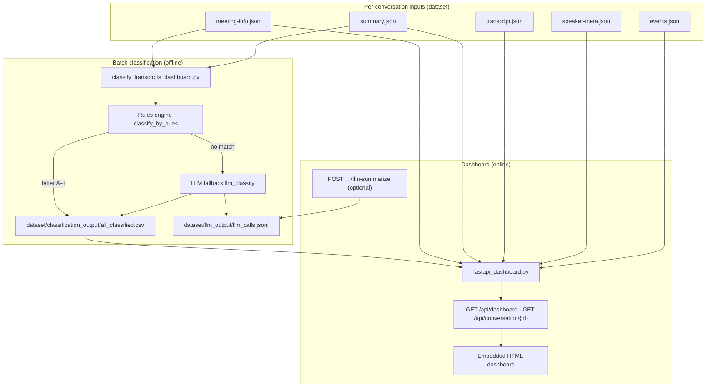
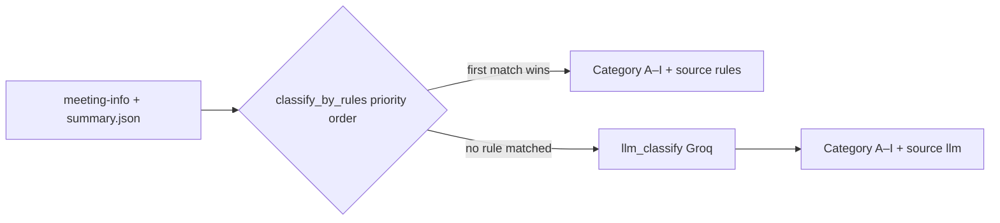
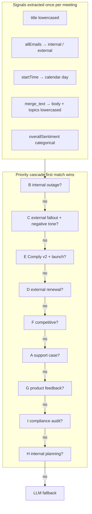

# Quorum — Architecture & Classification

This document describes how meeting data is split into categories, when the LLM runs, which JSON fields drive each step, and how the pieces connect. It matches the current code under `src/`.

**Styled HTML (dashboard link):** run `python3 scripts/build_architecture_html.py` to regenerate `docs/ARCHITECTURE.html` after editing this file. The FastAPI route `/architecture` serves that HTML when present.

---

## 0. Hybrid on-demand (“lazy”) LLM approach

This project uses a **hybrid** strategy: **cheap, wide batch labeling** first, and **expensive, deep LLM work** only when a human asks for it — also called **on-demand** or **lazy** evaluation from a token-budget perspective.

### Phase 1 — classify every conversation (no full transcript to the model)

- **Inputs:** `meeting-info.json` and `summary.json` per folder — notably **title**, **summary text**, **topics**, **sentiment** (`sentimentScore` / `overallSentiment`), and **participant emails** (internal vs external).
- **Mechanism:** Deterministic **rules** assign most meetings to a single letter **A–I**. If no rule matches, a **short** LLM call (`llm_classify`) still receives only those structured fields — **not** the full transcript — to emit one letter.
- **Output:** `dataset/classification_output/all_classified.csv` powers stakeholder dashboards for **all** meetings at once.

### Phase 2 — summarise only when an owner wants more

- **Trigger:** A user opens a meeting in the UI and explicitly runs **“Process transcript with LLM”**.
- **Mechanism:** `POST /api/conversation/{id}/llm-summarize` sends **metadata plus the full plain transcript** (capped for context) so the model can produce an analyst-style Markdown brief.
- **Why:** Avoid **blindly** summarising every call in batch (high token cost, latency, and little value if nobody reads it). Deep LLM work follows **business interest**, not automatic fan-out.

### Why “hybrid”

| Layer | What runs | Token posture |
|-------|-------------|----------------|
| Batch taxonomy | Rules + optional **tiny** LLM (letter only) | Minimise model input; no transcript |
| On-demand insight | **Full transcript** summarisation | Pay only when a stakeholder requests it |

### Per-conversation bundle (six JSON files)

When you walk **every** folder under `dataset/<conversation_id>/`, the same **bundle shape** appears: about **six** JSON artifacts per meeting. Together they split **“what kind of meeting was this?”** (cheap, repeatable) from **“what exactly was said, line by line?”** (rich, heavy).

| File | What it holds | Role in batch classification (A–I) |
|------|----------------|--------------------------------------|
| **`meeting-info.json`** | `meetingId`, **title**, **startTime** / endTime, duration, **`allEmails`**, invitees | Rules lean on **title**, **calendar day** (for time-windowed incidents), and **internal vs external** roster (`@aegiscloud.com` boundary in code). |
| **`summary.json`** | **Narrative `summary`**, **`topics`** (tag list), **`overallSentiment`** / **`sentimentScore`**, optional `actionItems`, `keyMoments` | **Main text surface** for keyword / sentiment rules — already a **distilled** read of the call, not raw transcript. |
| **`transcript.json`** | Time-coded utterances (full spoken text) | **Not** used for `classify_by_rules` or `llm_classify`; kept for UI drill-down and **on-demand** `POST …/llm-summarize`. |
| **`speaker-meta.json`** | Speaker ids / display metadata | Supports dashboard flyout; **not** the primary signal for letter choice. |
| **`speakers.json`** | Additional speaker rollups where present | Same — presentation and attribution, not the first-pass taxonomy layer. |
| **`events.json`** | Join/leave and related events if captured | Same — operational detail for timelines, not required to decide A–I in batch. |

So batch logic intentionally concentrates on **two** files — **`meeting-info.json` + `summary.json`** — because they are **small, comparable across all conversations, and semantically dense** for “bucket this meeting.”

### Patterns observed across files (why rules-first + hybrid LLM)

These patterns come from **reading many conversations** and comparing the same meeting across all six artifacts:

1. **`summary.json` reads like a well-processed product, not raw capture.** It usually contains a single coherent paragraph, a **curated topic list** (e.g. “billing dispute”, “migration cleanup”), and **sentiment** that align with how a human would label the call. That makes **deterministic rules** over `summary` + `topics` + sentiment **trustworthy for most meetings** without sending the full transcript to a model.
2. **`meeting-info.json` is structurally stable.** Title and email roster are **short and consistent** from file to file — good for high-precision guards (“Support Case #…”, “all internal emails”, “any external domain”).
3. **The transcript duplicates the “class” story at high token cost.** For answering **which letter A–I**, the transcript often **repeats** what the summary already captured; using it in batch for every call would **burn tokens and latency** for little extra accuracy on coarse taxonomy.
4. **Speaker / event files cluster around UI depth.** They matter for **who said what** and **join order** in the FastAPI drill-down; they rarely change the **first-order** question “renewal vs outage vs support vs GTM” that the rules encode.

**Design conclusion:** A **hybrid** approach matches that layout — **rule-based (and optional tiny LLM) batch labelling** over **`meeting-info` + `summary`**, because the data pattern shows those files already carry the **important, fine-grained text** for categorisation; **full-transcript LLM** stays **on-demand** for the minority of cases where a stakeholder wants **analyst-grade** detail beyond the summary, or where the summary alone is insufficient.

---

## 1. High-level architecture

**Roles**

| Component | Purpose |
|-----------|---------|
| `classify_transcripts_dashboard.py` | Walks each conversation folder, assigns **one letter A–I**, writes CSV + optional HTML charts. |
| `fastapi_dashboard.py` | Serves the SPA, reads the CSV for boards, loads **full bundles** for drill-down and optional **transcript-level** LLM summary. |
| `llm_model_config.py` | Shared Groq OpenAI-compatible client (`ModelSingleton`). |
| `llm_call_logger.py` | Append-only JSONL log of LLM **inputs and outputs** (and errors). |

---

## 2. How many categories, and what they mean

There are **nine primary taxonomy letters: A through I**. Each meeting gets **exactly one** letter for reporting. The canonical names and stakeholder mapping mirror `src/plan.yaml` and `CATEGORY_LABELS` / `PRIMARY_STAKEHOLDER_BY_CATEGORY` in code.

| Letter | Category name | Primary stakeholder key |
|--------|-----------------|---------------------------|
| **A** | Technical Support & Troubleshooting | `support_leaders` |
| **B** | Platform Outage & Incident Response | `support_leaders` |
| **C** | Customer Outage Fallout & Churn Risk | `support_leaders` |
| **D** | Contract Renewal & Commercial Negotiation | `sales_managers` |
| **E** | Comply v2 Launch & Go-to-Market | `sales_managers` |
| **F** | Competitive Threat & Win/Loss Analysis | `sales_managers` |
| **G** | Customer Product Feedback & Feature Requests | `product_managers` |
| **H** | Engineering Planning & Execution | `engineering_leads` |
| **I** | Compliance & Audit Preparation | `engineering_leads` |

**Stakeholder dashboards** slice the same rows into four views (each view shows a **subset** of letters), e.g. Support Operations uses **A, B, C**; Revenue & Growth uses **D, E, F**; etc.

**Sub-themes (A1, A2, …, I3)** are **curated human-readable examples** (27 lines total: three per letter). They appear in the UI as a **reference strip** only. The classifier assigns **the letter**, not an automatic A1/B2 sub-tag.

---

## 3. Classification mechanism: rules first, then LLM

### 3.1 Rule pass (`classify_by_rules`)

Rules are evaluated in a **fixed priority order** (first `True` wins). Order is intentional (e.g. internal outage **B** before customer fallout **C**). For **why keywords are hardcoded**, **which fields feed each rule**, and a **per-letter business reading**, see **§4**.

The evaluation order is:

1. **B** — `is_outage_internal` (internal roster + outage/incident language in title or dated summary/topics)
2. **C** — `is_outage_fallout` (external customer + fallout/churn language)
3. **E** — `is_comply_v2_launch` (Comply v2 / launch GTM signals)
4. **D** — `is_renewal_call` (renewal / commercial patterns)
5. **F** — `is_competitive_analysis` (competitors, win/loss, deal intelligence)
6. **A** — `is_support_case` (support / break-fix style)
7. **G** — `is_product_feedback` (feedback / roadmap / feature asks)
8. **I** — `is_compliance_audit` (audit / SOC2 / ISO / HIPAA style, with title guards vs demos)
9. **H** — `is_engineering_planning` (internal-only + planning cadence, excluding incident titles)

If **none** of these return `True`, the rule pass returns **`None`** and the pipeline calls the LLM.

### 3.2 LLM fallback (`llm_classify`)

- **When:** Only if `classify_by_rules` returns `None`.
- **Why:** Cover ambiguous meetings where keywords and heuristics do not clearly fit one bucket.
- **What is sent (token-conscious):** **Not** the full transcript. The model receives a **short structured prompt** built from:
  - `meeting_info.title`
  - `summary.summary` (narrative body)
  - `summary.topics` (joined as text)
  - **Sentiment** from `summary.sentimentScore` + `summary.overallSentiment` (via `get_sentiment`)
  - **External vs internal** hint from `meeting_info.allEmails` (via `is_external_call`)
  - Inline reminders of A–I definitions
- **Output:** Model is asked to reply with **a single letter**; code parses the first valid **A–I** with `parse_llm_letter`. If the model is missing, mis-parsed, or errors, behavior falls back to **H** (with logging where applicable).

So **batch classification saves tokens** by using **rules for every meeting that matches**, and only paying for an LLM round trip when rules abstain.

### 3.3 On-demand transcript summary (dashboard only)

- **Route:** `POST /api/conversation/{conversation_id}/llm-summarize`
- **When:** User explicitly clicks **“Process transcript with LLM”** in the UI (not part of batch CSV generation).
- **What is sent:** Server builds a blob from **metadata + full plain transcript** (`transcript_plaintext_for_llm`), capped at **120,000 characters** with a truncation suffix if longer (to respect context limits).
- **Why separate:** This is **analyst-grade narrative**, not taxonomy; it would be far more expensive to run for every meeting in batch.

---

## 4. Rules-based filtering (`classify_transcripts_dashboard.py`)

This section answers: **what kind of rules**, **are they hardcoded**, **why**, and **what business logic / algorithms** they encode.

### 4.1 Are the rules “hardcoded”?

**Yes.** Each category detector is implemented as **Python functions with fixed keyword lists, date ranges, and product-name strings** embedded in source (for example `markers`, `fallout_terms`, `launch_terms`, `rivals`, `signals`, `frameworks` in `is_*` helpers).

There is **no** external rules YAML driving the matchers today (taxonomy *names* are mirrored in `plan.yaml` for humans, but the **if/then heuristics** live in code).

### 4.2 Why hardcode heuristics instead of “learn from all fields”?

The pipeline **does** observe the main structured fields that exist for every bundle (`meeting-info.json` + `summary.json`): **title**, **participant emails**, **start time**, **summary text**, **topics**, and **sentiment**. It does **not** mine arbitrary keys dynamically; instead it applies **hand-authored patterns** that came from **domain observation** (how your meetings are titled, how outages and renewals are phrased, etc.).

Reasons this design is intentional:

| Reason | Effect |
|--------|--------|
| **Determinism** | Same inputs → same label every run; easy to audit for compliance or disputes. |
| **Cost & speed** | No model call for the majority of meetings that match obvious language. |
| **Explainability** | You can point to “title contained `war room` + all internal emails → B”. |
| **Priority story** | Business order is explicit: e.g. **internal incident (B) before customer fallout (C)** so one meeting cannot satisfy both in conflicting ways—the **first** winning rule wins. |
| **LLM as safety net** | Anything that does not hit a lexicon still gets a **cheap** single-letter classification from a **short** prompt (not the full transcript). |

Trade-off: new vocabulary, new competitors, or new products **will not** match until someone **extends the lists** or the meeting falls through to the **LLM**.

### 4.3 Shared primitives (algorithms used everywhere)

These are the building blocks every rule composes:

| Primitive | Role |
|-----------|------|
| **`merge_text(summary)`** | Concatenates `summary.summary` with stringified `summary.topics`; returns **lowercased body** plus **lowercased topics blob** for substring checks. |
| **`get_sentiment(summary)`** | Reads `sentimentScore` (numeric) and `overallSentiment` (string); used where tone matters (notably category **C**). |
| **`parse_meeting_day(startTime)`** | Parses calendar day from ISO `startTime` prefix `YYYY-MM-DD` for **time-windowed** rules. |
| **`is_internal_call` / `is_external_call` (`allEmails`)** | **Hardcoded tenant boundary:** every address must end with `@aegiscloud.com` for “internal”; **external** if any participant is outside that domain. Empty email lists raise `ValueError` and the caller treats the check as “no match” for that signal. |
| **Priority router `classify_by_rules`** | Strict **if / elif** chain: **first function that returns `True` assigns the letter** and stops. |

### 4.4 Rule-by-rule business logic (what each detector encodes)

Below is what each `is_*` function is *trying* to capture in business language. (Exact strings are in code.)

| Order | Letter | Function | Business intent | Typical signals (hardcoded patterns) |
|------:|--------|----------|-------------------|----------------------------------------|
| 1 | **B** | `is_outage_internal` | **Internal war-room / platform incident response** — staff-only bridges, RCAs, not customer venting. | All participants `@aegiscloud.com` **and** (title contains incident/outage/war-room/root-cause/escalation-bridge language **or** meeting day in **2026-03-10 … 2026-03-18** with summary mentioning **outage** or **pipeline** — a **fixed post-mortem window** aligned to the “March 10th Detect outage” story in `plan.yaml`). |
| 2 | **C** | `is_outage_fallout` | **Customer-facing fallout** — churn pressure, credits, competitors after reliability pain. | At least one **external** email **and** summary/topic text hits fallout terms (outage, SLA, churn, competitor, etc.) **and** `overallSentiment` is a **negative / mixed-negative** bucket (requires sentiment field to be present). |
| 3 | **E** | `is_comply_v2_launch` | **Comply v2 GTM lifecycle** — launch, preview, onboarding, readiness. | Title or merged summary must mention **`comply v2`**, plus launch vocabulary (launch, GA, preview, demo, early access, onboarding, kickoff, readiness). |
| 4 | **D** | `is_renewal_call` | **Commercial / renewal** conversations with customers. | **External** call **and** renewal/pricing/contract language in **title**, **topics**, or **body**. |
| 5 | **F** | `is_competitive_analysis` | **Competitive intelligence** — explicit win/loss or named rivals in evaluative context. | Title phrases like “competitive”, “win/loss”, “vendor comparison” **or** fictional rival names in body (`sentinelshield`, `vaultedge`, …) **together with** evaluative words (“evaluating”, “versus”, “vs ”, …). |
| 6 | **A** | `is_support_case` | **Reactive technical support** — break-fix, integrations, errors. | Title contains **`support case #`** **or** (**external** + body hits troubleshooting tokens: bug, timeout, connector, sync failure, latency, …). |
| 7 | **G** | `is_product_feedback` | **Structured product / roadmap feedback** from customers. | **External** + hits in title/topics/body for “feature request”, “roadmap”, “pain point”, “feature gap”, etc. |
| 8 | **I** | `is_compliance_audit` | **Audit / certification prep** (SOC2, ISO, HIPAA, PCI, evidence). | Title/topics/body framework language; **guards** so a title that is only a “demo/preview” does not false-positive unless audit words still appear. |
| 9 | **H** | `is_engineering_planning` | **Internal engineering cadence** — default “how we build” bucket when incident language is absent. | **All internal** emails; title must include cadence tokens (sprint, standup, retro, roadmap, planning, sync, all hands, …) and **not** outage / incident / war room / root cause in the title; if specific planning phrases appear in merged summary they reinforce the match, but the function **still returns True when the title alone matched cadence vocabulary** (see code tail). |

Together, this is a **lexicon + roster + calendar + sentiment** expert system—not machine learning on embeddings, but a **transparent policy engine** with a **strict precedence order**.

---

## 5. Which fields from the data are used

### 5.1 Batch classification (per conversation folder)

**Loaded files (required for classify):**

| File | Fields / usage (representative) |
|------|-----------------------------------|
| **meeting-info.json** | `title`, `allEmails` (internal/external), `startTime` (date windows in some rules), `duration` (CSV output), `host` / `organizerEmail` (not used in rule letter choice; used elsewhere in the app) |
| **summary.json** | `summary` (text body), `topics` (list), `sentimentScore`, `overallSentiment` — merged and searched by rules; same fields feed the LLM fallback prompt |

Rules combine **title**, **email roster**, and **summary text/topics** (and sometimes **meeting day** from `startTime`) according to each `is_*` helper in `classify_transcripts_dashboard.py`.

**CSV row** (`build_row_record`) additionally exposes: `conversation_id`, `category`, `category_label`, `stakeholder_primary`, `classification_source` (`rules` or `llm`), `sentiment_score`, `duration_min`, `start_date`, `title`.

### 5.2 FastAPI drill-down (not used for batch letter choice)

For `GET /api/conversation/{id}`, the server may read **meeting-info.json**, **speaker-meta.json**, **events.json**, **summary.json**, **transcript.json** to power participants, join/leave, saved summary, and colored transcript lines in the flyout.

---

## 6. LLM logging

All logged calls append one JSON object per line to:

- **Default path:** `dataset/llm_output/llm_calls.jsonl`
- **Override:** environment variable `TI_LLM_LOG_FILE`

Each record includes **agent instructions**, **full user input** sent to the model, **response** (or `null`), optional **error**, and **extras** (e.g. `conversation_id`, `model_name`, `call_site` such as `llm_classify` vs `summarize_transcript_via_llm`).

---

## 7. Key outputs on disk

| Artifact | Produced by |
|----------|-------------|
| `dataset/classification_output/all_classified.csv` | `classify_transcripts_dashboard.py` |
| `dataset/classification_output/*_view.csv` | Same (per stakeholder slice) |
| `dataset/llm_output/llm_calls.jsonl` | `llm_call_logger.append_llm_call_log` from classify + dashboard summarize |

---

## 8. Mental model in one sentence

**Nine categories (A–I)** segment every meeting for dashboards; **deterministic rules** over **title + summary + topics + emails (+ dates)** assign most labels cheaply; the **LLM** only runs when rules abstain (short prompt), and a **second, separate LLM** path optionally summarizes the **full transcript** on user demand, with both paths optionally recorded in **`llm_calls.jsonl`**.

---

## 9. Q & A — “duplicates” and the four stakeholder views

### Q1: Does this system contain duplicate *documents* (meeting bundles or CSV master rows)?

**No.** Each conversation still has **one** directory under `dataset/<conversation_id>/` and **one** row per meeting in the master file `dataset/classification_output/all_classified.csv` (one **A–I** letter per meeting from rule-based filtering + optional LLM fallback). There is no second copy of the transcript or meeting JSON created just for categorisation.

### Q2: Then why does the same meeting seem to appear more than once?

**Yes — you will see the same meeting listed under more than one of the four stakeholder dashboards.** That is **not** errant duplication of files; it is **by design**.

- Each of the **four** tabs (Support Operations, Revenue & Growth, Product Strategy, Engineering Execution) is a **filtered view** over the **same** underlying rows.
- The views are built from **overlapping sets of category letters** on purpose, so multiple leadership audiences can see a meeting when the theme concerns them both.

Examples from the current dashboard config:

| Category letter | Can appear in these stakeholder tabs (non-exhaustive overlap) |
|-----------------|------------------------------------------------------------------|
| **E** (Comply v2 launch) | Revenue & Growth **and** Product Strategy (both include **E**). |
| **F** (Competitive) | Revenue & Growth **and** Product Strategy (both include **F**). |
| **B** (Platform outage / incident) | Support Operations **and** Engineering Execution (both include **B**). |

So the “duplicate” you notice is the **same row** surfaced in **multiple slices**, not two different classifications or two copies of the bundle.

### Q3: How does that relate to rule-based filtering?

**Rule-based filtering assigns exactly one letter A–I** (plus `classification_source` rules vs LLM). The **four** stakeholder boards are **orthogonal**: they are **presentation filters** that map those letters onto **four** curated “lanes.” Overlap is a product requirement: one meeting, one letter, **many** possible interested audiences—implemented as **shared letters** across view definitions, not duplicate storage.

### Q4: What is `stakeholder_primary` in the CSV if views overlap?

The CSV still carries a **single** `stakeholder_primary` (derived from `PRIMARY_STAKEHOLDER_BY_CATEGORY` in code) for reporting ownership, while the **UI tabs** deliberately show any meeting whose **letter** is in that tab’s allowed list—even if the primary stakeholder key differs from the tab name. Read **primary** as “accountable home,” not “only place this row may appear.”
